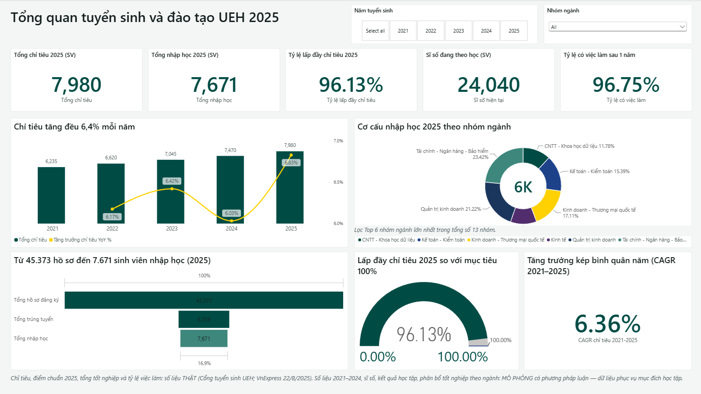
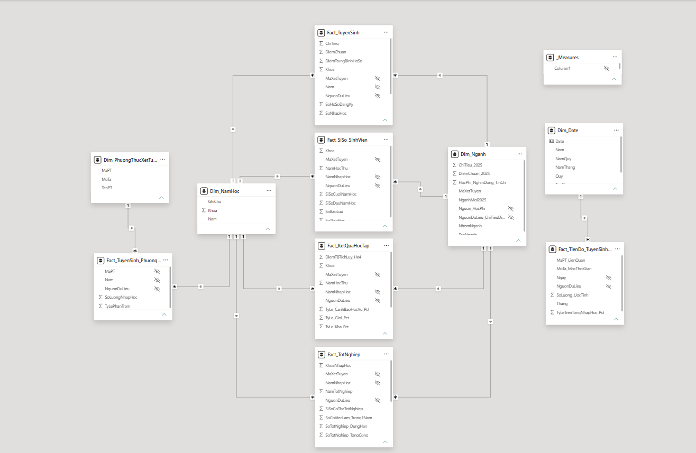
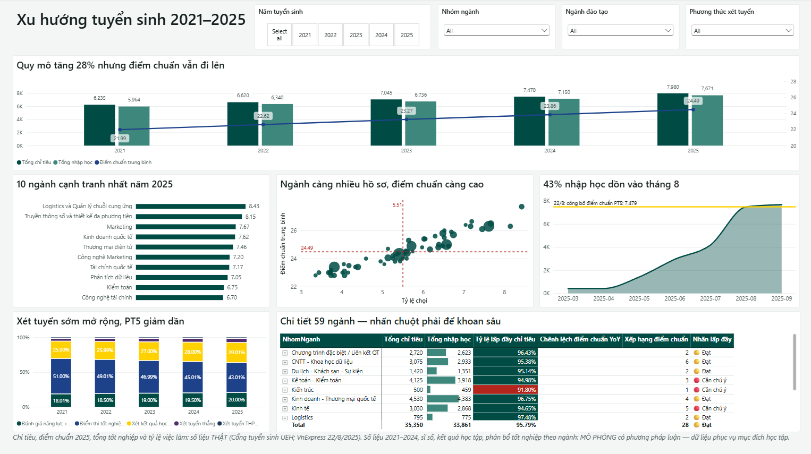
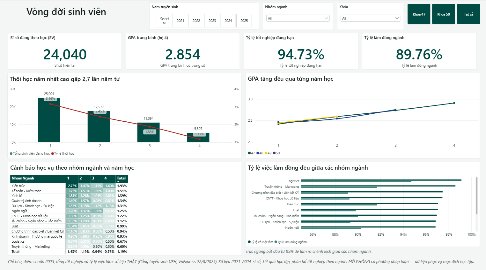
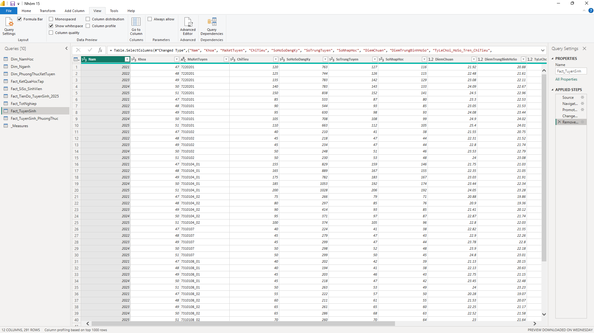
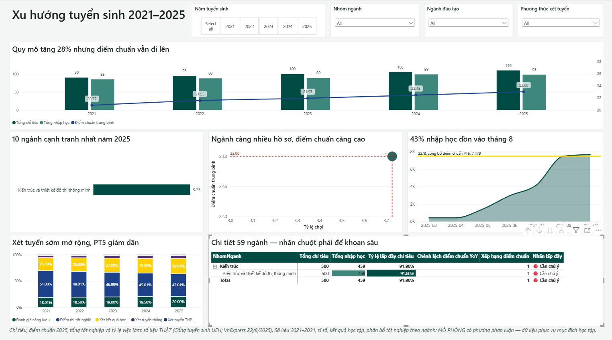

# UEH Admissions & Training Analytics – Power BI

**English** · [Tiếng Việt](#tiếng-việt)

An interactive Power BI report analysing admissions and training outcomes at the University of Economics Ho Chi Minh City (UEH, HCMC campus), 2021–2025: quotas and cut-off scores, applicant-to-enrolment funnel, enrolment by faculty group, student lifecycle (dropout, GPA, academic warnings) and graduate employment.

Course project for Management Information Systems (practice) at the University of Labour and Social Affairs (Campus II). Team of 3. **Nguyen Huu An** built the whole analytical product: dataset design, data cleaning in Power Query, star-schema data model, DAX measures, dashboard design and insights. Teammates presented the results and prepared the slides.

## What's inside

| File | Description |
|---|---|
| `UEH-Admissions-Dashboard.pbix` | Power BI report: 3 dashboard pages + drill-through and tooltip pages |
| `data/UEH_2025_DuLieu_TuyenSinh_DaoTao.xlsx` | Source dataset: 3 dimension tables, 6 fact tables and a methodology sheet |
| `UEH_Theme.json` | Custom report theme |

## Report pages

1. **Overview** – 2025 quota (7,980), enrolment, fill rate, current headcount, employment rate, 5-year quota trend, application → admission → enrolment funnel, CAGR.
2. **Trends & programmes** – quota vs. enrolment vs. average cut-off score, the 10 most competitive programmes, applications-per-seat vs. cut-off scatter, cumulative 2025 enrolment timeline, admission-method mix, and a 59-programme matrix with fill-rate flags.
3. **Student lifecycle & graduation** – dropout by year of study, GPA progression by cohort, academic-warning heatmap, employment vs. in-field employment by faculty group. Bookmarks switch between cohorts 47 and 50.

Plus a drill-through page per programme and a custom tooltip page.

## Data model

Star schema: `Dim_Nganh` (59 programmes), `Dim_NamHoc`, `Dim_PhuongThucXetTuyen`, `Dim_Date` and the facts `Fact_TuyenSinh`, `Fact_TuyenSinh_PhuongThuc`, `Fact_TienDo_TuyenSinh_2025`, `Fact_SiSo_SinhVien`, `Fact_KetQuaHocTap`, `Fact_TotNghiep`. Measures are kept in a dedicated `_Measures` table.

## About the data

The dataset was built by the author. Figures for 2025 (quotas, cut-off scores, graduates, employment rate) come from public UEH announcements and VnExpress (22/08/2025). Figures for 2021–2024 and student-level metrics (headcount, GPA, academic results, graduation by programme) are **simulated** with a documented method anchored to those real figures. Every table has a `NguonDuLieu` column marking each row as real (`THẬT`) or simulated (`MÔ PHỎNG`). The data is for learning purposes, not official UEH statistics.

## How to open

1. Install [Power BI Desktop](https://www.microsoft.com/power-bi/desktop) (free, Windows).
2. Open `UEH-Admissions-Dashboard.pbix`. The visuals load from the data cached in the file.
3. To refresh from the Excel file: **Transform data → Data source settings → Change source…**, point it to `data/UEH_2025_DuLieu_TuyenSinh_DaoTao.xlsx`, then **Refresh**.

## More screenshots

| Trends & programmes | Student lifecycle |
|---|---|
|  |  |
| **Power Query steps** | **Drill-through** |
|  |  |

Developed with help from Claude (AI assistant); all decisions, checks and review were done by the author.

---

## Tiếng Việt

Báo cáo Power BI phân tích tuyển sinh và kết quả đào tạo của Trường Đại học Kinh tế TP.HCM (UEH, cơ sở TP.HCM) giai đoạn 2021–2025: chỉ tiêu, điểm chuẩn, phễu hồ sơ → trúng tuyển → nhập học, cơ cấu theo nhóm ngành, vòng đời sinh viên (thôi học, GPA, cảnh báo học vụ) và việc làm sau tốt nghiệp.

Bài thực hành môn Hệ thống thông tin quản lý, Trường Đại học Lao động – Xã hội (CS II). Nhóm 3 người. **Nguyễn Hữu An** thực hiện toàn bộ sản phẩm phân tích: xây dựng bộ dữ liệu, làm sạch bằng Power Query, mô hình dữ liệu dạng sao, DAX, thiết kế dashboard và rút ra nhận định. Hai thành viên còn lại thuyết trình và làm slide.

**Dữ liệu**: số liệu năm 2025 (chỉ tiêu, điểm chuẩn, số tốt nghiệp, tỷ lệ có việc làm) lấy từ thông báo công khai của UEH và VnExpress (22/8/2025). Số liệu 2021–2024 và các chỉ số cấp sinh viên là **mô phỏng** có phương pháp, neo theo số thật. Cột `NguonDuLieu` ghi rõ từng dòng là THẬT hay MÔ PHỎNG. Dữ liệu phục vụ mục đích học tập.

**Cách mở**: cài Power BI Desktop, mở `UEH-Admissions-Dashboard.pbix`. Muốn làm mới dữ liệu thì vào Transform data → Data source settings → Change source, chọn tệp Excel trong thư mục `data/`, rồi Refresh.

Dự án có sự hỗ trợ của Claude (trợ lý AI); mọi quyết định, kiểm tra và rà soát do tác giả thực hiện.
